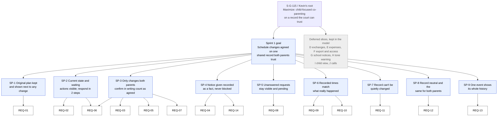

# Goal model and sprint decisions

Project: co-parenting schedule, expense and communication app (ABC Design Services)
Team: Samarth Shukla, Kevin Huang

This file covers Step 1 of the assignment. We reviewed both of our A2 goal models, merged them, and chose the goals that make up the system boundary for this sprint. Step 2 adds the analysis of overlaps, dependencies and conflicts to this same file.

## 0. Notation

| Prefix | Meaning | Where to find it |
|---|---|---|
| `S-G-n` | Goal in Samarth's A2 combined model | `docs/sources/a2-goal-models/samarth/goal_model_combined.py` |
| `K-G-n` | Goal in Kevin's A2 combined model | `docs/sources/a2-goal-models/kevin/goal_model_combined.py` |
| `SP-n` | Sprint goal (a merged goal in this sprint's model) | section 4 |
| `REQ-nn` | Sprint requirement | `docs/initial-spec.md`, written in Step 3 |
| `E-nn` | Stakeholder quote with its transcript line | `docs/evidence.md` |
| `X-n` | Conflict | analysed in Step 2 |

Both of our A2 models numbered goals from G-1, so the IDs clashed. We decided not to renumber. Each original ID keeps its number and gets an `S-` or `K-` prefix, which means anything we trace in this sprint can still be looked up in the A2 submission it came from. When an A2 model had already merged a goal into another one, we cite the goal it was merged into. For example, Kevin merged K-G-53 into K-G-10, so we cite K-G-10.

## 1. What we merged

We interviewed the same three stakeholders (Melissa, Jason and Ruth) separately. So the merge combines two independent sets of evidence about one system.

| | Samarth's A2 | Kevin's A2 |
|---|---|---|
| Interviews | 5 (Melissa twice, Jason twice, Ruth once) | 3 (one each) |
| Goals after merging | about 130, IDs up to G-173, 25 of them tacit | 71, one tacit (K-G-49) |
| Use cases | 13 | 9 |
| Conflicts recorded | 8 conflicts and 6 inconsistencies | 1 conflict (K-G-4 vs K-G-35) |

Samarth's model goes deeper on how a schedule change gets agreed. It covers notice and emergencies, the rule that silence never counts as agreement, neutral wording, and who can see the record. Kevin's model is smaller, but it has detail Samarth's lacks. Ruth asked Kevin for failed deliveries to be visible (E-34) and for anything unverified to be "marked plainly as unavailable or unverified" (E-59). Melissa used the phrase "immutable audit trail" with Kevin and described pickups as "completed, refused, or missed" (E-39, E-49). Jason gave Kevin the truck stop story (E-36), a concrete case of a message being sent hours after it was written.

We both found the same notice conflict on our own. Melissa expects 48 hours and Jason can't always give it. It appears as C-2 in Samarth's model and as the K-G-4 vs K-G-35 link in Kevin's. Since it came out of two separate sets of interviews, we're confident it's a real conflict between the stakeholders and not something one of us caused by how we asked the questions.

One result surprised us. Samarth's model had a tacit goal, S-G-152, saying a tone warning would be private to the sender and kept out of the record. Nobody had actually said that. In Kevin's interview Ruth says the opposite: the parent's choice "should remain visible in the record" (E-50), and a mediator should see it without reading it as misconduct (E-51). We kept S-G-152 in the model but now treat it as contradicted by evidence (see X-6 in Step 2).

## 2. Choosing the sprint scope

We sorted the merged goals into ten candidate slices and rated each one on the handout's three criteria: core, user-facing, and high uncertainty. We also asked whether other slices depend on it, since a slice that everything else needs should come first.

| Slice | Main goals | Core | User-facing | Uncertainty | Others depend on it | Decision |
|---|---|---|---|---|---|---|
| A. Agreeing schedule changes | S-G-7, 8, 11, 16, 19; K-G-31, 33, 49 | High (E-01, E-02, E-03) | High | High (X-1, X-5) | Yes | In sprint |
| B. Timing of requests and responses | S-G-80 to 84, 119, 148; K-G-36 to 39, 72 | High (E-62) | High | High (X-2, X-3) | Yes, notice is calculated from it | In sprint, requests and responses only |
| C. A record nobody can quietly change | S-G-117, 120 to 123; K-G-10, 51 | High (E-38, E-41) | Medium | Medium | Yes, every other slice | In sprint |
| D. Recording actual exchanges | S-G-34 to 36, 78; K-G-8, 9 | High | High | High (X-4) | Export | Sprint 2 |
| E. Expenses and disputes | S-G-42 to 53, 97, 100; K-G-12 to 16, 41 to 45 | High | High | Low | Export | Sprint 2 |
| F. Export and reviewer access | S-G-54, 131 to 135; K-G-55, 58 to 68 | Medium | Low | Medium | No | Sprint 3 |
| G. School and doctor notices | S-G-85 to 89; K-G-27 to 30 | Medium | High | High | No | Sprint 3 |
| H. Tone warning | S-G-138 to 141, 152; K-G-73 to 76 | Low | Medium | High (X-6) | No | Later |
| I. Older child's schedule view | S-G-62, 151; K-G-6 | Low | Medium | Low | No | Later |
| J. Urgent phone calls | S-G-93 to 95, 118, 137 | Low | Low | High (X-7) | No | Outside the app |

We picked slices A, B and C and treat them as one feature: a parent asks to change the schedule, and both parents can trust the record of what happened.

It's core because the custody schedule was the first thing every stakeholder named when we asked what the app has to get right (E-01, E-02, E-03). The record from slice C is also something almost every later slice relies on. Exchanges, expenses and exports all have to be stored with an author and a trusted time.

It's user-facing because both parents use it every week. Melissa's biggest worry was that Jason would refuse to use a complicated app (E-56). The fix she described, a couple of obvious steps and the waiting action shown up front (E-09, E-10), is entirely about what the user sees.

It has the most uncertainty because it contains the two conflicts we are least sure how to settle. One is the 48-hour notice rule against Jason's route changes. The other is whether to trust the time on a phone or on the server. A prototype is the cheapest way to find out which reading the stakeholders actually need.

Expenses were the hardest slice to leave out. They are just as core and just as visible to users. But the interviews already settle the rules: medical and school costs are split 50/50, and child support stays separate (E-63, E-64). A prototype of expenses would mostly confirm what we already know. A prototype of the notice and timing rules can tell us something new.

## 3. How the goals were merged into sprint goals

| Sprint goal | From Samarth | From Kevin | What the merge kept from each side |
|---|---|---|---|
| SP-1 Original court plan kept and shown next to any change | S-G-3, 4, 5, 6 | K-G-3 | Samarth: the plan is shown next to every change and never replaced (E-05). Kevin: the plan is the base calendar (E-04) |
| SP-2 Current state and waiting actions visible at once, response in two steps or fewer | S-G-57, 58, 60, 61, 161 | K-G-78 | Kevin's Ruth wants it simple enough to use "during a stressful exchange" (E-11) |
| SP-3 Only changes both parents confirm in writing count as agreed | S-G-7, 8, 9, 11, 12, 13, 14, 16, 18, 73, 160 | K-G-22, 24, 31, 32, 33, 49 | Kevin's "decision recorded" goal (K-G-24) and Samarth's rule that silence never counts as agreement (E-22) |
| SP-4 The notice given is recorded as a fact, and a request is never blocked for it | S-G-19, 20, 21, 22, 23, 74, 147, 168, 170 | K-G-4, 5, 23, 35 | Kevin modelled a normal-notice path and a short-notice path. Samarth labelled late requests (S-G-147). Melissa's own condition: "only if it truly works for the kids" (E-17) |
| SP-5 Unanswered requests stay visible and pending | S-G-15, 17, 169 | K-G-47 | Jason told Kevin he got no answer "until the weekend was basically over" (E-28) |
| SP-6 Recorded times match what really happened | S-G-80, 81, 82, 83, 84, 90, 119, 148 | K-G-36, 37, 38, 39, 72 | Kevin adds failed delivery as its own visible state (E-34) |
| SP-7 The record can't be quietly changed | S-G-117, 120, 121, 122, 123 | K-G-7, 10, 11, 51 | Ruth told Kevin that edits should be "new, linked events" (E-40). Melissa said the record "can't be quietly changed" (E-39) |
| SP-8 The record is neutral and the same for both parents | S-G-106, 109, 142, 143, 149 | K-G-25, 46 | Jason told Kevin the records shouldn't be "used to make me look bad" (E-44). Ruth worried the app could become "a weapon" (E-46) |
| SP-9 One event shows its whole history | S-G-32, 33 | K-G-23, 52 | Melissa told Kevin she needs the message and "what notice it referred to" (E-48) |

## 4. Sprint goal model (Step 1)

Arrows are refinements. The grey node holds the slices we deferred; they stay in the model. Each REQ leaf is written out in Step 3.

## 5. Deferred goals

None of these goals were removed. They're planned for later sprints.

| Slice | Main goals | Evidence | Why it waits | When |
|---|---|---|---|---|
| D. Actual exchanges | S-G-34 to 36, 78, 157 to 159; K-G-8, 9 | E-49, E-55, E-71 | Needs the record from slice C first, and the wording of outcomes is still in dispute (X-4) | Sprint 2 |
| E. Expenses and disputes | S-G-42 to 53, 97, 100, 128 to 130; K-G-12 to 16, 41 to 45 | E-63, E-64, E-54 | The rules are already clear, so a prototype would teach us less. It's also independent of slice A | Sprint 2 |
| F. Export and reviewer access | S-G-54 to 56, 131 to 135, 150; K-G-55, 58 to 68 | E-65, E-66 | There's nothing to export until D and E exist | Sprint 3 |
| G. School and doctor notices | S-G-85 to 89; K-G-27 to 30 | E-67, E-70 | Depends on outside systems that a mock can't really stand in for | Sprint 3 |
| H. Tone warning | S-G-138 to 141, 152; K-G-73 to 76 | E-69, E-50, E-51 | Who should see the warning is unresolved (X-6) | After we ask Ruth and Jason |
| I. Child view | S-G-62, 151; K-G-6 | E-68 | Lower priority than the parents' needs | Later |
| J. Urgent calls | S-G-93 to 95, 118, 137 | E-52, E-53 | Stays outside the app until someone checks what the court order allows | Not planned |
