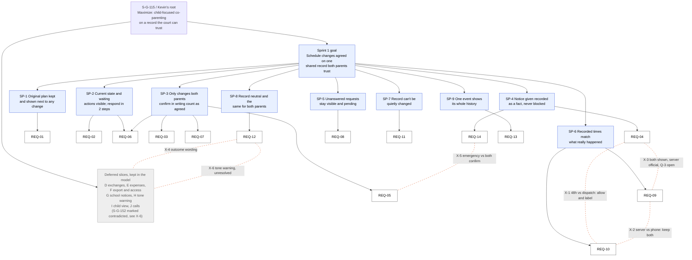

# Goal model and sprint decisions

Project: co-parenting schedule, expense and communication app (ABC Design Services)
Team: Samarth Shukla, Kevin Huang

This file covers Steps 1 and 2 of the assignment. In Step 1 we reviewed both of our A2 goal models, merged them, and chose the goals that make up the system boundary for this sprint (sections 1 to 4). In Step 2 we looked at how the selected requirements overlap, depend on each other and conflict, decided what to do about each, and updated the goal model to show those decisions (sections 4 to 6).

## 0. Notation

| Prefix | Meaning | Where to find it |
|---|---|---|
| `S-G-n` | Goal in Samarth's A2 combined model | `docs/sources/a2-goal-models/samarth/goal_model_combined.py` |
| `K-G-n` | Goal in Kevin's A2 combined model | `docs/sources/a2-goal-models/kevin/goal_model_combined.py` |
| `SP-n` | Sprint goal (a merged goal in this sprint's model) | section 4 |
| `REQ-nn` | Sprint requirement | `docs/initial-spec.md`, written in Step 3 |
| `E-nn` | Stakeholder quote with its transcript line | `docs/evidence.md` |
| `O-n`, `D-n`, `X-n` | Overlap, dependency, conflict | section 5 |
| `A-n`, `Q-n` | Assumption, open question for stakeholders | section 6 |

Both of our A2 models numbered goals from G-1, so the IDs clashed. We decided not to renumber. Each original ID keeps its number and gets an `S-` or `K-` prefix, which means anything we trace in this sprint can still be looked up in the A2 submission it came from. When an A2 model had already merged a goal into another one, we cite the goal it was merged into. For example, Kevin merged K-G-53 into K-G-10, so we cite K-G-10.

## 1. What we merged

We interviewed the same three stakeholders (Melissa, Jason and Ruth) separately. So the merge combines two independent sets of evidence about one system.

| | Samarth's A2 | Kevin's A2 |
|---|---|---|
| Interviews | 5 (Melissa twice, Jason twice, Ruth once) | 3 (one each) |
| Goals after merging | about 130, IDs up to G-173, 25 of them tacit | 71, one tacit (K-G-49) |
| Use cases | 13 | 9 |
| Conflicts recorded | 8 conflicts and 6 inconsistencies | 1 conflict (K-G-4 vs K-G-35) |

Samarth's model goes deeper on how a schedule change gets agreed. It covers notice and emergencies, the rule that silence never counts as agreement, neutral wording, and who can see the record. Kevin's model is smaller, but it has detail Samarth's lacks. Ruth asked Kevin for failed deliveries to be visible (E-34) and for anything unverified to be "marked plainly as unavailable or unverified" (E-59). Melissa used the phrase "immutable audit trail" with Kevin and described pickups as "completed, refused, or missed" (E-39, E-49). Jason gave Kevin the truck stop story (E-36), a concrete case of a message being sent hours after it was written.

We both found the same notice conflict on our own. Melissa expects 48 hours and Jason can't always give it. It appears as C-2 in Samarth's model and as the K-G-4 vs K-G-35 link in Kevin's. Since it came out of two separate sets of interviews, we're confident it's a real conflict between the stakeholders and not something one of us caused by how we asked the questions.

One result surprised us. Samarth's model had a tacit goal, S-G-152, saying a tone warning would be private to the sender and kept out of the record. Nobody had actually said that. In Kevin's interview Ruth says the opposite: the parent's choice "should remain visible in the record" (E-50), and a mediator should see it without reading it as misconduct (E-51). We kept S-G-152 in the model but now treat it as contradicted by evidence (see X-6 in section 5.3).

## 2. Choosing the sprint scope

We sorted the merged goals into ten candidate slices and rated each one on the handout's three criteria: core, user-facing, and high uncertainty. We also asked whether other slices depend on it, since a slice that everything else needs should come first.

| Slice | Main goals | Core | User-facing | Uncertainty | Others depend on it | Decision |
|---|---|---|---|---|---|---|
| A. Agreeing schedule changes | S-G-7, 8, 11, 16, 19; K-G-31, 33, 49 | High (E-01, E-02, E-03) | High | High (X-1, X-5) | Yes | In sprint |
| B. Timing of requests and responses | S-G-80 to 84, 119, 148; K-G-36 to 39, 72 | High (E-62) | High | High (X-2, X-3) | Yes, notice is calculated from it | In sprint, requests and responses only |
| C. A record nobody can quietly change | S-G-117, 120 to 123; K-G-10, 51 | High (E-38, E-41) | Medium | Medium | Yes, every other slice | In sprint |
| D. Recording actual exchanges | S-G-34 to 36, 78; K-G-8, 9 | High | High | High (X-4) | Export | Sprint 2 |
| E. Expenses and disputes | S-G-42 to 53, 97, 100; K-G-12 to 16, 41 to 45 | High | High | Low | Export | Sprint 2 |
| F. Export and reviewer access | S-G-54, 131 to 135; K-G-55, 58 to 68 | Medium | Low | Medium | No | Sprint 3 |
| G. School and doctor notices | S-G-85 to 89; K-G-27 to 30 | Medium | High | High | No | Sprint 3 |
| H. Tone warning | S-G-138 to 141, 152; K-G-73 to 76 | Low | Medium | High (X-6) | No | Later |
| I. Older child's schedule view | S-G-62, 151; K-G-6 | Low | Medium | Low | No | Later |
| J. Urgent phone calls | S-G-93 to 95, 118, 137 | Low | Low | High (X-7) | No | Outside the app |

We picked slices A, B and C and treat them as one feature: a parent asks to change the schedule, and both parents can trust the record of what happened.

It's core because the custody schedule was the first thing every stakeholder named when we asked what the app has to get right (E-01, E-02, E-03). The record from slice C is also something almost every later slice relies on. Exchanges, expenses and exports all have to be stored with an author and a trusted time.

It's user-facing because both parents use it every week. Melissa's biggest worry was that Jason would refuse to use a complicated app (E-56). The fix she described, a couple of obvious steps and the waiting action shown up front (E-09, E-10), is entirely about what the user sees.

It has the most uncertainty because it contains the two conflicts we are least sure how to settle. One is the 48-hour notice rule against Jason's route changes. The other is whether to trust the time on a phone or on the server. A prototype is the cheapest way to find out which reading the stakeholders actually need.

Expenses were the hardest slice to leave out. They are just as core and just as visible to users. But the interviews already settle the rules: medical and school costs are split 50/50, and child support stays separate (E-63, E-64). A prototype of expenses would mostly confirm what we already know. A prototype of the notice and timing rules can tell us something new.

## 3. How the goals were merged into sprint goals

| Sprint goal | From Samarth | From Kevin | What the merge kept from each side |
|---|---|---|---|
| SP-1 Original court plan kept and shown next to any change | S-G-3, 4, 5, 6 | K-G-3 | Samarth: the plan is shown next to every change and never replaced (E-05). Kevin: the plan is the base calendar (E-04) |
| SP-2 Current state and waiting actions visible at once, response in two steps or fewer | S-G-57, 58, 60, 61, 161 | K-G-78 | Kevin's Ruth wants it simple enough to use "during a stressful exchange" (E-11) |
| SP-3 Only changes both parents confirm in writing count as agreed | S-G-7, 8, 9, 11, 12, 13, 14, 16, 18, 73, 160 | K-G-22, 24, 31, 32, 33, 49 | Kevin's "decision recorded" goal (K-G-24) and Samarth's rule that silence never counts as agreement (E-22) |
| SP-4 The notice given is recorded as a fact, and a request is never blocked for it | S-G-19, 20, 21, 22, 23, 74, 147, 168, 170 | K-G-4, 5, 23, 35 | Kevin modelled a normal-notice path and a short-notice path. Samarth labelled late requests (S-G-147). Melissa's own condition: "only if it truly works for the kids" (E-17) |
| SP-5 Unanswered requests stay visible and pending | S-G-15, 17, 169 | K-G-47 | Jason told Kevin he got no answer "until the weekend was basically over" (E-28) |
| SP-6 Recorded times match what really happened | S-G-80, 81, 82, 83, 84, 90, 119, 148 | K-G-36, 37, 38, 39, 72 | Kevin adds failed delivery as its own visible state (E-34) |
| SP-7 The record can't be quietly changed | S-G-117, 120, 121, 122, 123 | K-G-7, 10, 11, 51 | Ruth told Kevin that edits should be "new, linked events" (E-40). Melissa said the record "can't be quietly changed" (E-39) |
| SP-8 The record is neutral and the same for both parents | S-G-106, 109, 142, 143, 149 | K-G-25, 46 | Jason told Kevin the records shouldn't be "used to make me look bad" (E-44). Ruth worried the app could become "a weapon" (E-46) |
| SP-9 One event shows its whole history | S-G-32, 33 | K-G-23, 52 | Melissa told Kevin she needs the message and "what notice it referred to" (E-48) |

## 4. Sprint goal model

Arrows are refinements. Red dashed lines are the conflicts from section 5.3, labelled with their decision. The grey node holds the slices we deferred; they stay in the model. Each REQ leaf is written out in `docs/initial-spec.md`.

We updated this diagram in Step 2. The conflict links are new, and so is the note on S-G-152, which Kevin's evidence contradicts.

## 5. Relationships between the selected requirements

### 5.1 Overlaps

Some goals from the two models turned out to be the same need in different words. Others looked alike but had to stay apart. For each pair we decided whether to combine them, build them separately, or prioritise one.

| ID | Overlap | Decision | Reason |
|---|---|---|---|
| O-1 | S-G-11 (status pending, accepted or declined) and K-G-49 (status visible while waiting for a decision) | Combine into REQ-05 | Same need. K-G-49 was Kevin's only tacit goal, and Melissa says it outright in Samarth's interview (E-21), so the merged goal now has evidence behind it |
| O-2 | S-G-81 to 83 (written, sent, delivered and read times) and K-G-37 to 39, K-G-72 | Combine into REQ-09 | Jason gives us "when I wrote it" (E-30, E-31) and Ruth gives us failed delivery (E-34). Neither model had all five states on its own |
| O-3 | S-G-121 and 122 (audit trail, changed items stay visible) and K-G-10 (original entries and correction history) | Combine into REQ-11 | Melissa (E-39) and Ruth (E-38, E-40, E-75) describe the same append-only behaviour |
| O-4 | S-G-147 (late request labelled), K-G-35 (short notice allowed) and K-G-5 (late change considered if it works for the kids) | Combine into REQ-04 | These are three views of one rule. The request goes through, it gets labelled, and the other parent decides |
| O-5 | S-G-106 and 149 (no judgments or tallies) and K-G-25 (records credible, fair and accurate) | Combine into REQ-12 | In both models "fair" ends up meaning the same thing: the app never judges, and both parents get the same rules |
| O-6 | S-G-33 (one event shows everything) and S-G-59 (message, calendar and expense areas kept separate) | Build both, as REQ-13 and REQ-02 | This was inconsistency I-4 in Samarth's A2. Separate areas make things easy to find, and the event view links the related items together |
| O-7 | S-G-169 (overdue) and S-G-11 (pending) | Build separately. Overdue is a flag on a pending request, not a new status | Melissa doesn't want an unanswered request to look like a decision (E-26) |
| O-8 | K-G-55 (hashes and chain of custody) and S-G-121 (append-only audit trail), two ways to make tampering visible | Prioritise the append-only trail for V1. Hashes wait for the export slice | Hashes only matter when someone outside the app checks an export. Inside the app, visible edit events already cover what Ruth and Melissa asked for (E-38, E-39) |

### 5.2 Dependencies

| ID | Dependency | What it means for the build |
|---|---|---|
| D-1 | REQ-05, 07, 08 and 09 all write to the record, so they depend on REQ-11 | The event log and the trusted clock get built first |
| D-2 | REQ-03 and REQ-07 depend on REQ-01. A request points at an event in the court plan, and an agreed change is drawn next to it | The plan has to be loaded before any request can exist |
| D-3 | REQ-04 depends on REQ-09, because notice is measured from a recorded time | Which time we use is conflict X-3 below |
| D-4 | REQ-10 depends on REQ-09. A request saved offline has a written time but no server time yet | It must never show as sent while it's still waiting on the phone |
| D-5 | Deferred slices D, E and F all depend on REQ-11 | This is the main reason slice C is in this sprint |

### 5.3 Conflicts

Every conflict below stays in the goal model (section 4). We didn't settle any of them by deleting a goal.

#### X-1. 48-hour notice against short notice caused by dispatch

This is a strong conflict between Melissa and Jason, and it's the one we both found on our own (S C-2, and K-G-4 vs K-G-35). Melissa says the plan requires 48 hours (E-15, E-16) and that a work problem isn't an emergency (E-20). Jason says he can't promise 48 hours (E-18, E-19). He also told Kevin that when he did ask in time, he was accused of making plans without permission (E-29).

We looked at three options. Blocking requests under 48 hours would favour Melissa, but it leaves Jason no proper way to ask, which is exactly how the argument he described started. Ignoring the rule would go against the court plan. The third option was to let the request through, record how much notice was given, and leave the decision to the other parent. We went with that compromise. A short-notice request is never blocked. It's labelled "Short notice: N h given" in neutral words, and like any request it still needs both parents to agree in writing (SP-3). This also fits Melissa's own condition, that she'd consider a late change "only if it truly works for the kids" (E-17). What we can't settle ourselves is whether the court order allows short-notice changes when both parents agree. That's question Q-1.

#### X-2. Server time against phone time

A weaker conflict between Jason and Ruth (S C-3), and Kevin's interviews back it up. Ruth wants times from a trusted server because phone clocks can be wrong (E-32, E-33). Jason needs proof of when he wrote something while he had no signal (E-30, E-31, E-62). Our compromise keeps both times. The server time is the official one. The phone's "written" time is always shown with the label "device time, not verified". That follows Ruth's own advice for anything that can't be checked (E-59).

#### X-3. Which time counts toward notice?

Neither A2 model had this one. It only showed up when we put X-1 next to X-2. Say Jason writes a swap request at a truck stop with no signal, 50 hours before pickup (E-36), and it reaches the server 46 hours before. If we count from the server time, he gave short notice even though he did the right thing. If we count from his phone, he gave enough notice, but nobody can verify it (E-32). For V1 we're counting from the server time, because that's the time everyone can trust, and the request also shows when it was written. We aren't sure this is right. It's the main thing V1 is meant to test, and we've listed it as Q-3.

#### X-4. How outcomes are worded

This conflict sits between the two models. Melissa told Kevin she wants pickups marked "completed, refused, or missed" (E-49). Jason told Samarth he wants weekends shown as "happened, swapped, or changed because of work" (E-55), and never in a way that makes him "look bad" (E-43, E-44). For request outcomes in V1 we use wording that describes what happened and who acted, never what the person is like. Examples: "Pending", "Agreed by both parents", "Declined by Melissa, original schedule applies". Nothing is counted or totalled (S-G-149). Recording actual pickups, where words like "missed" would come up, is in deferred slice D, and the conflict stays open there.

#### X-5. Emergency override against "nothing agreed unless both confirm"

This one is inside Melissa's own interviews (inconsistency I-1 in Samarth's A2). In her first interview she says the original schedule stays in place "unless there's an emergency or another formal decision" (E-60). In the follow-up she says nothing should look agreed unless both parents confirm in writing (E-22), and Jason says the same thing (E-23). We went with the later and more explicit statement, since both parents share it. A claimed emergency is recorded with its reason (REQ-14) and can change how notice is labelled, but it never changes the calendar by itself. How an emergency override would actually work depends on what a "formal decision" is. That's Q-4.

#### X-6. Who sees a tone warning

This is between Ruth in Kevin's interview and Samarth's tacit goal S-G-152, with Jason's concerns in the background. It's outside this sprint, but we're recording it now. Ruth told Kevin that a warning, and whether the parent dismissed it, should stay visible in the record (E-50, E-51). S-G-152 said the opposite, with no evidence behind it. Jason worries about the record being used against him (E-44). We've left this unresolved. We marked S-G-152 as contradicted by evidence instead of deleting it, and added K-G-76 as the alternative a stakeholder actually asked for. That's Q-5.

#### X-7. Written-only contact against urgent calls

A strong conflict between Melissa and Jason (S C-1), outside the sprint. Melissa says the court order limits contact to writing (E-52). Jason wants to be able to call when it's urgent (E-53). Same decision as in A2: calls stay outside the app until someone checks what the order really says. That's Q-6.

## 6. Assumptions and open questions

We had to assume a few things to make the spec testable. The ones we're least sure about are A-3 and A-4, so they're the first things to check in V1.

| ID | Assumption for V1 | Why we needed it | Used in |
|---|---|---|---|
| A-1 | One case with two parents. Signing in is mocked with a "Viewing as Melissa / Jason" switch | The prototype has to show both sides without real accounts | REQ-02 |
| A-2 | The server is simulated inside the app. Its clock is the trusted time, and you can shift a phone's clock to show what skew looks like | A mock prototype has no backend | REQ-09, REQ-11 |
| A-3 | Notice = start of the affected exchange minus the time the server received the request | Needed so X-3 has a definite answer we can test | REQ-04 |
| A-4 | A request counts as overdue after 48 hours with no answer, or once the exchange is less than 24 hours away, whichever comes first | Melissa talks about a "notice period" for replies (E-26) but never says how long it is | REQ-08 |
| A-5 | A request can claim no emergency, an unexpected child illness, or a genuine emergency. The app records the claim and never judges it | Uses Melissa's definitions (E-20, E-61). The app must not judge (E-43) | REQ-14 |
| A-6 | Mock schedule: alternating weekends from November 2026, pickup Friday 6:00 pm at the school parking area, drop-off Sunday 6:00 pm | Pickup time and place come from S-M1:31 and 33. We made up the Sunday time | REQ-01 |
| A-7 | "Read" means the other parent opened the request in the app | Gives Jason's "delivered or read" (E-30) a concrete meaning | REQ-09 |
| A-8 | Only messages that belong to a request (its reason, the response, follow-ups) are in scope. General chat is not | Keeps slice B small, and keeps messages tied to an issue (S-G-32) | REQ-09 |
| A-9 | Only one pending request per scheduled exchange at a time. A second one waits until the first is resolved | Added during `/speckit-clarify`. No stakeholder spoke about this, but two agreed changes for one weekend would contradict each other, which breaks E-22 and E-38 | REQ-03, REQ-05 |
| A-10 | Declining with an alternative closes the first request as Declined and opens a new request with the roles swapped | Added during `/speckit-clarify`. Changing the first request in place would break append-only (E-40), and the swap means the counter-offer still needs written agreement | REQ-06, REQ-11 |
| A-11 | A sender can edit only the proposed time and the alternative date. The event, reason and emergency tag stay as sent, and extra context goes in a follow-up | Added during `/speckit-clarify`. Rewriting the reason after the other parent read it is the quiet change Melissa and Ruth warned about (E-39, E-38) | REQ-11, REQ-14 |

These are the questions we'd take back to the stakeholders.

| ID | Question | Ask | Comes from |
|---|---|---|---|
| Q-1 | Does the parenting plan allow a short-notice change if both parents agree in writing? | Melissa, and the order itself | X-1 |
| Q-2 | How long does the other parent have to reply before a request counts as overdue? | Melissa, Jason | A-4 |
| Q-3 | Should notice count from when the request was written or from when it reached the server? | Melissa, Jason, Ruth | X-3 |
| Q-4 | What counts as a "formal decision" that can override the schedule, and who records it? | Melissa, Ruth | X-5 |
| Q-5 | Should tone warnings and dismissals be visible to the other parent and the mediator? | Ruth, Jason | X-6 |
| Q-6 | What exactly does the court order say about phone calls? | Melissa, Jason | X-7 |

## 7. Deferred goals

None of these goals were removed. They're planned for later sprints.

| Slice | Main goals | Evidence | Why it waits | When |
|---|---|---|---|---|
| D. Actual exchanges | S-G-34 to 36, 78, 157 to 159; K-G-8, 9 | E-49, E-55, E-71 | Needs the record from slice C first, and the wording of outcomes is still in dispute (X-4) | Sprint 2 |
| E. Expenses and disputes | S-G-42 to 53, 97, 100, 128 to 130; K-G-12 to 16, 41 to 45 | E-63, E-64, E-54 | The rules are already clear, so a prototype would teach us less. It's also independent of slice A | Sprint 2 |
| F. Export and reviewer access | S-G-54 to 56, 131 to 135, 150; K-G-55, 58 to 68 | E-65, E-66 | There's nothing to export until D and E exist | Sprint 3 |
| G. School and doctor notices | S-G-85 to 89; K-G-27 to 30 | E-67, E-70 | Depends on outside systems that a mock can't really stand in for | Sprint 3 |
| H. Tone warning | S-G-138 to 141, 152; K-G-73 to 76 | E-69, E-50, E-51 | Who should see the warning is unresolved (X-6) | After Q-5 is answered |
| I. Child view | S-G-62, 151; K-G-6 | E-68 | Lower priority than the parents' needs | Later |
| J. Urgent calls | S-G-93 to 95, 118, 137 | E-52, E-53 | Stays outside the app until Q-6 is answered | Not planned |

## 8. Revisions after evaluating V1

We used V1 in the browser before changing the specification. The evaluation confirmed one implementation defect, five requirements issues, and four usability candidates in `docs/traceability.md`. We kept every V1 goal, conflict and open question. These revisions change how the selected goals are met in V2.

### 8.1 X-3 notice-time compromise

V1 used only the server-received time for its notice label. In F-6, Jason wrote at a truck stop 50 hours before the exchange, but the request reached the server 46 hours before and was labelled short notice. Using only the server time follows Ruth's trusted-time rule (E-32), but it hides the situation Jason described (E-30, E-31, E-36, E-62).

V2 keeps the server figure as the official notice value and threshold decision. When the written and server figures differ, it also shows the written figure as context, labelled "device time, not verified". The truck-stop example becomes "Short notice: 46 h at server; written 50 h before (device time, not verified)". This does not treat the phone clock as trusted. Q-3 stays open because Melissa, Jason and Ruth still need to decide which figure should count outside this prototype.

The X-3 link in the goal model is therefore revised from "server, open" to "both shown, server official, Q-3 open". SP-4 and SP-6 are better supported because V2 shows the trusted decision and the unverified context together.

### 8.2 Refined assumptions

| ID | V2 assumption | Finding | Used in |
|---|---|---|---|
| A-12 | "Read" means the recipient explicitly opens the request details. Rendering a card in Home or Requests does not count. | F-3 | REQ-09 |
| A-13 | An item waiting because the recipient is offline is labelled "Waiting to be delivered (other parent offline)". This is distinct from the failure state "Not delivered". | F-4 | REQ-09 |
| A-14 | An item that exists only on the sender's device shows "Not sent yet" instead of a request status. It also shows its written device time. | F-1, F-2 | REQ-05, REQ-10 |
| A-15 | After a recorded delivery failure, the sender may retry. A successful retry appends a delivery event and keeps the earlier failure in the history. | F-5 | REQ-09, REQ-11 |

### 8.3 Usability decisions

F-7 to F-10 do not introduce a new product capability. They make existing flows understandable and usable at the required 375 px width.

- F-7: the selected parent is shown with a persistent, high-contrast state in the existing A-1 switch (REQ-02, SP-2).
- F-8: a successful request submission shows a visible confirmation and opens Requests, where the new request can be reviewed (REQ-02, REQ-03, SP-2, SP-3).
- F-9: request events and their timestamps use separate lines and spacing (REQ-09, REQ-13, SP-6, SP-9).
- F-10: the alternative datetime input keeps a valid `datetime-local` value until confirmation, so the existing decline-with-alternative requirement can be completed (REQ-06, SP-2, SP-3). Code inspection showed that V1 replaced the control's local value with an ISO value it could not display, so we classify F-10 as an implementation defect.

### 8.4 Deferred decision

We did not add automatic repeated delivery attempts or background notifications. V2 provides an explicit retry after a recorded failure. Production retry timing and limits need infrastructure and stakeholder input that are outside this prototype. The deferred slices D to J remain unchanged.

### 8.5 What verifying V2 changed in the model

Using V2 in the browser found four more implementation defects (F-11 to F-14 in `docs/traceability.md`). None of them changes a goal or a decision, because the spec already described the right behaviour. They do change how well two sprint goals are met. In V1, SP-6 ("recorded times match what really happened") was only partly met: a request sent while the other parent was offline never showed as delivered, and the delivered time vanished once something was read. V2 meets SP-6 fully. SP-8 (neutral record) is also met more completely, because the History area now uses the same neutral labels as the rest of the app. All conflicts X-1 to X-7 and questions Q-1 to Q-6 stay in the model, with X-3 and Q-3 updated as described in 8.1.

